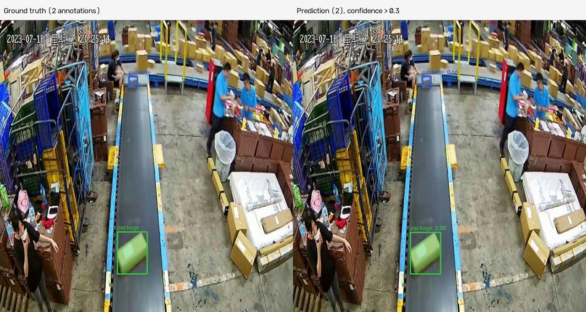
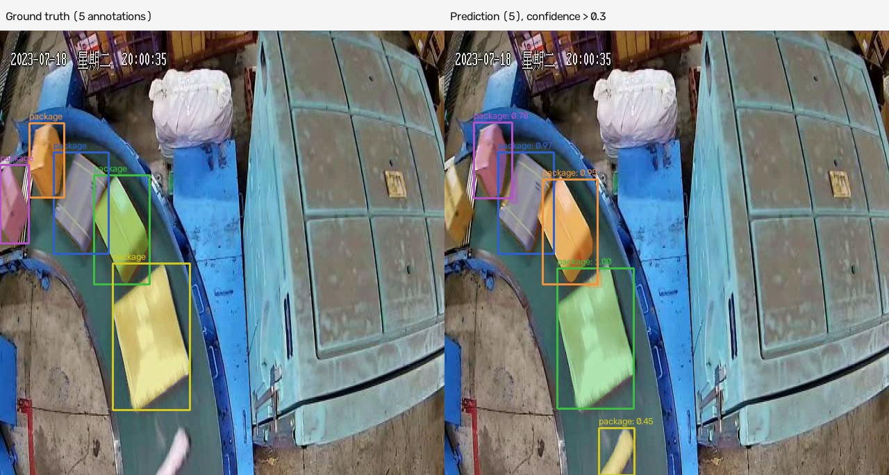
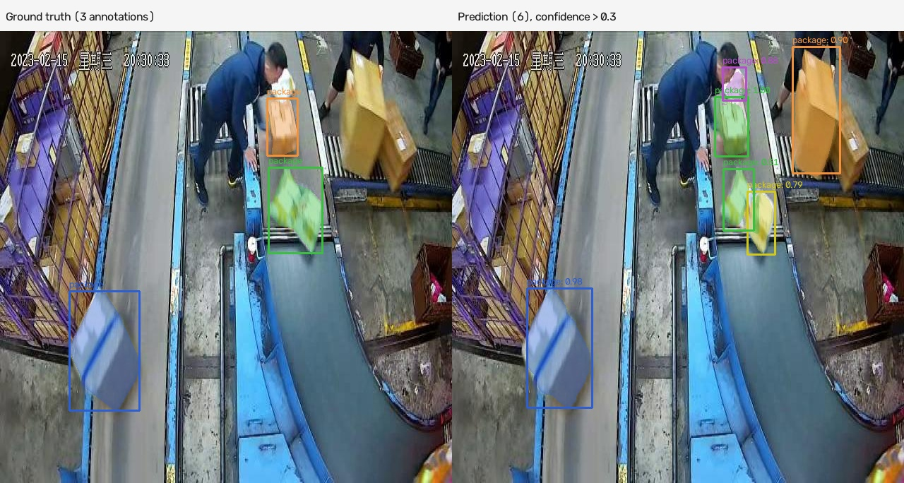

# Package Instance Segmentation with YOLACT

Fine-tuning YOLACT to detect individual packages and predict a separate mask for each package. The project includes YOLO-polygon-to-COCO conversion, dataset auditing, on-the-fly augmentation, resumable training, and visual comparison with test annotations.

The completed run used Apple Silicon MPS, 550-pixel inputs, and a physical batch size of one. Model computation used MPS with CPU operator fallback disabled; data loading and image rendering use the CPU.

## Test examples

Each comparison shows **ground truth on the left** and **predictions on the right**, including instance masks, boxes, and confidence scores. Predictions are displayed above a confidence threshold of 0.30. Colors identify instances independently in each panel; they do not indicate matched objects.







These examples are selected from saved test visualizations. They illustrate predictions and do not replace evaluation on the complete test split.

## Final validation results

Results below are **validation results**, evaluated after the final training epoch.

| Metric | Bounding boxes | Instance masks |
|---|---:|---:|
| mAP50–95 | 67.26% | **68.19%** |
| AP50 | 86.51% | 85.25% |
| AP75 | 78.58% | 77.93% |
| AP90 | 34.17% | 44.01% |
| AP95 | 2.22% | 9.65% |

Final validation loss on annotated images: **2.8184**. AP averages across IoU thresholds from 0.50 to 0.95 in increments of 0.05. The mAP values above are percentages, rather than fractions.

Validation AP uses all 188 validation images, including images without annotations for false-positive accounting. Validation loss uses annotated images only. Training loss is measured with augmentation; validation loss is measured without augmentation.

## Dataset

One foreground category: **package**. Polygon labels are converted to COCO instance-segmentation annotations.

| Split | Images used | Annotated instances |
|---|---:|---:|
| Training | 1,803 | 6,625 |
| Validation | 188 | 693 |
| Test | 89 | 325 |

The original training split contains 1,920 images. The 117 images without annotations were excluded using an annotated-only training manifest. Original images and annotations are preserved locally. Validation and test splits are unchanged.

Dataset images, full annotations, pretrained weights, and trained checkpoints are excluded from Git. Obtain the Package-Seg dataset separately and arrange it locally as follows:

```text
data/images/train/     data/labels/train/
data/images/val/       data/labels/val/
data/images/test/      data/labels/test/
data/package-seg.yaml
```

The dataset YAML must define the class names. COCO manifests are generated into `data/annotations/`.

## Repository layout

| Path | Purpose |
|---|---|
| `scripts/convert_yolo_seg_to_coco.py` | Convert polygon labels to COCO |
| `scripts/audit_coco_dataset.py` | Audit generated annotations |
| `scripts/exclude_unannotated_train.py` | Create the annotated-only training manifest |
| `scripts/check_training_batch.py` | Check pretrained loading and forward/backward execution |
| `scripts/fine_tune.py` | Train, resume, and evaluate final weights |
| `scripts/inspect_results.py` | Plot history and save test comparisons |
| `vendor/yolact/` | YOLACT source with the project configuration and portability changes |
| `docs/images/` | Three selected test comparisons |
| `docs/results/` | Small exported training/validation records, when available |

The trainer reads `package_seg_config` from `vendor/yolact/data/config.py` and its command-line arguments. The starter YAML in `configs/` is not the trainer's authoritative configuration.

## Setup and data preparation

Use a Python environment with compatible PyTorch and Torchvision installations. Install the remaining dependencies:

```bash
python -m pip install -r requirements.txt
```

The completed run used Python 3.11 and an Apple Silicon M1. MPS availability can be checked with:

```bash
python -c "import torch; print(torch.backends.mps.is_available())"
```

Retain the modified `vendor/yolact/` source in this repository: it includes the MPS tensor-convolution implementation and other compatibility changes used by this project. Replacing it with a fresh upstream checkout can remove those changes.

Place the pretrained checkpoint at `vendor/yolact/weights/yolact_base_54_800000.pth`. Configure `package_seg_config` with the local dataset paths and package class, then prepare the manifests:

```bash
python scripts/convert_yolo_seg_to_coco.py
python scripts/exclude_unannotated_train.py
python scripts/check_training_batch.py --device auto
```

## Training

Start a new run in an unused output directory:

```bash
caffeinate -i python scripts/fine_tune.py \
  --device auto --epochs 100 --batch-size 1 \
  --lr 0.0001 --log-every 100
```

Training uses `SSDAugmentation` at load time, frozen batch normalization, SGD, an epoch-based learning-rate schedule, and gradient clipping. Progress prints at the first batch and every 100 batches. Checkpoints save after each epoch; validation runs once after all requested epochs finish.

The completed run encountered numerical instability during epoch 20. It resumed from the completed epoch-19 checkpoint with a lower learning rate, cleared SGD momentum, and gradient clipping:

```bash
caffeinate -i python scripts/fine_tune.py \
  --device auto --epochs 100 --batch-size 1 \
  --lr 0.0001 --log-every 100 --resume \
  --resume-lr 0.00001 --reset-momentum --max-grad-norm 10
```

Use the recovery command only with the corresponding existing checkpoint. For an ordinary resume, append `--resume` to the original training command. The trainer replays an incomplete epoch from the last completed-epoch checkpoint. A new uninterrupted run can produce different results from the reported recovered run.

Outputs are written to `runs/yolact_package_seg/`, including `last_training.pt`, `final_model.pth`, `history.csv`, and `final_validation_metrics.json`.

## Test visualization and plots

With the local final checkpoint available:

```bash
python scripts/inspect_results.py --device auto --count 20 --threshold 0.30
```

Use `--count 0` for the entire test split. Side-by-side images are saved to `runs/yolact_package_seg/test_visualizations/`.

For plots without inference:

```bash
python scripts/inspect_results.py --plots-only
```

Plots in `runs/yolact_package_seg/plots/` include epoch-average training loss, learning rate, and final validation AP versus IoU threshold. There is no validation metric curve across epochs because validation ran only at the end. The trainer does not save per-epoch B/C/M/S histories.

Before inference, `inspect_results.py` must set evaluation mode without assigning the return value of `.eval()`, and enable Fast NMS:

```python
model = model.to(device)
model.eval()
model.detect.use_fast_nms = True
model.detect.use_cross_class_nms = False
```

## Acknowledgment

This project builds on [YOLACT by Daniel Bolya and contributors](https://github.com/dbolya/yolact). Preserve the upstream license and attribution files within `vendor/yolact/`. The three selected dataset visualizations are included for documenting model behavior; underlying dataset rights remain with their respective owners.
